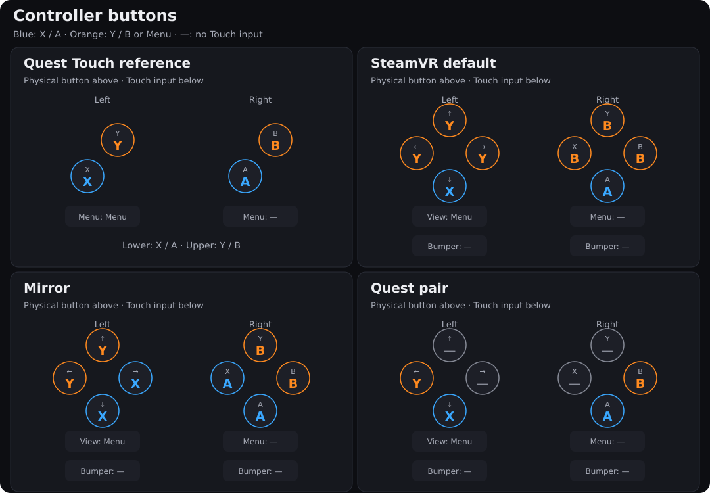

# Controller buttons

Quest games usually bind Quest Touch controllers. Steam Frame has a d-pad and View button on the left controller,
and an A/B/X/Y diamond and Menu button on the right. Without a game's own Frame bindings, SteamVR maps Touch X/A
to the bottom button and Touch Y/B to all three top buttons. View sends Touch Menu. The right X and Y therefore
send Touch B, rather than the left-hand X and Y of a Quest controller.

**Controller buttons** chooses an alternative for Quest games running through FrameBridge:

- **SteamVR default (0)** leaves SteamVR's Touch remapping in place. This is the initial default.
- **Mirror (1)** uses every face button. On each controller, bottom and inner send X/A; top and outer send Y/B.
- **Quest pair (2)** uses two face buttons per controller, diagonally placed like Touch. The other face buttons
  send no Touch input.



The small label identifies the physical button; the larger label is the Touch input the game receives. Blue is
X/A, orange is Y/B or Menu, and a dash means no Touch input. Left and right refer to the hand holding the controller.

<!-- quest-buttons-table:start -->
| Frame input | SteamVR default (0) | Mirror (1) | Quest pair (2) |
|---|---|---|---|
| Left d-pad ↑ | Y | Y | — |
| Left d-pad ↓ | X | X | X |
| Left d-pad ← | Y | Y | Y |
| Left d-pad → | Y | X | — |
| Left View | Menu | Menu | Menu |
| Right A (bottom) | A | A | A |
| Right B (right) | B | B | B |
| Right X (left) | B | A | — |
| Right Y (top) | B | B | — |
| Right Menu | — | — | — |
| Left bumper | — | — | — |
| Right bumper | — | — | — |
<!-- quest-buttons-table:end -->

The table describes button clicks and face-button touches. View sends Menu click only. Triggers, grip pressure,
thumbsticks, tracked poses and vibration keep their corresponding Touch bindings.

## Choose a mode

For one game, open its **Game settings → Controllers → Controller buttons**. Choose **Use global default** to
follow Settings, or select a specific mode to keep an override for that game. An explicit **SteamVR default**
keeps mode 0 even when the global choice is Mirror or Quest pair.

For the library default, open **Settings → Controllers**. The diagram follows the selected mode. New installs
and configuration updates use this default for games without an override. With a Frame connected, choose
**Apply to installed games now** to send it to installed Quest games that follow the global default. Overrides
are kept. Changing the default does not mark every game as needing an update.

Changes take effect at the **next launch**. Close and relaunch a running game.

The CLI can change an installed game's runtime setting:

```sh
frameport settings <pkg> quest_buttons=2
```

Use `0` for SteamVR default or `1` for Mirror. This command writes the installed settings directly; it does not
save a per-game recipe override. To keep the value through later installs and global applies, also save it in
the recipe, or use Game settings:

```sh
frameport recipe <pkg> --set quest_buttons=2
```

## Limits

- SteamVR's binding UI can still override these suggested bindings. Check custom bindings if the result differs
  from the diagram.
- Bumpers have no Touch counterpart and are unbound. Thumbrest touch is dropped; the Frame profile has no
  corresponding input. System buttons keep their runtime role.
- Mirror and Quest pair require the Frame runtime's `XR_VALVE_frame_controller_interaction` extension. If it is
  absent, FrameBridge logs that fact and leaves SteamVR's remap in place.
- Games using their own Frame bindings without suggesting Touch bindings are unaffected. These modes translate
  Touch suggestions; they do not invent actions for inputs the game never bound.
- The setting applies to Quest VR games, including 32-bit games through the bridge. It does not change PC VR or
  flat Android Steam Input layouts.

The mapping follows [Valve's Frame Controller input reference](https://partner.steamgames.com/doc/steamhardware/steamframe/input)
and the [shared mapping data](input/quest_buttons.json). To regenerate the diagram, app illustrations and table,
run `uv run python scripts/controller_diagram.py`; add `--check` to verify them without writing files.
